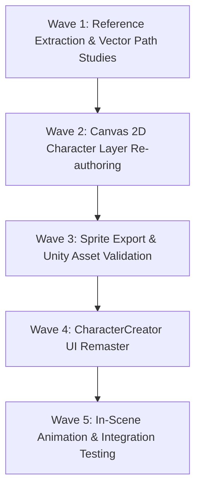

# GSD Plan: Character System Redesign (Authentic Hàng Rong Flash Style)

**Plan ID:** `PLAN-CHAR-01`  
**Created:** 2026-11-09  
**Status:** Completed (Verified in Unity 6 & Sprites Pipeline)  
**Target:** Replace modern anime/chibi character art and creator UI with authentic 2012–2013 VNG *Hàng Rong* Flash caricature style.

---

## 1. Context & Problem Statement

### 1.1 The Issue
The current character visual assets in `client/Tools/sprites.js` and the creation flow in `CharacterCreator.cs` suffer from stylistic drift:
1. **Anime/Chibi Aesthetic Drift**: Eyes feature oversized white sclera and dual anime-style catchlight gleams (`dot(83, 117, 3.2)` & `dot(76, 125, 1.6)`). Heads have sleek V-line jawlines and soft radial gradients, directly inspired by AI upscaled concept images rather than the authentic source material.
2. **Geometric Rigidity**: Characters are constructed using basic primitive ellipses and arcs, creating a robotic "vector graphic" feel instead of the fluid, expressive line art of Adobe Flash.
3. **Loss of Street Caricature Spirit**: Original *Hàng Rong* characters were characterized by cheeky, mischievous, working-class Vietnamese street caricatures (beady eyes, wry smirks, cheeky grins, band-aids on cheeks, honeycomb sandals, slouching postures).
4. **Creation UI Disconnection**: The `CharacterCreator` modal is a sterile two-column form with generic `< 1/4 >` steppers, missing the vibrancy, pedestal preview, and tactile playfulness of the original Zing Me game.

### 1.2 Objective
- Redesign and re-vectorize all character base bodies, hairstyles, facial features, and starting wearables in `client/Tools/sprites.js` to match the authentic 2012 Zing Me *Hàng Rong* Flash art style.
- Rebuild `CharacterCreator.cs` with an authentic Flash-era game feel: dynamic pedestal preview, idle/action anim toggles, dice randomize button, and responsive layout.
- Maintain 100% backward compatibility with the existing server protocol (`Appearance` interface, `LOOK_OPTIONS`, `createCharacter` message, `lookString` format).

---

## 2. Art Direction & Style Specification

### 2.1 Anatomy & Proportions
| Aspect | Current (Flawed) | Target (*Hàng Rong* Zing Me Flash) |
| :--- | :--- | :--- |
| **Head-to-body ratio** | ~1 : 3 (Tall chibi) | **~1 : 2 to 1 : 2.2** (Chubby caricature chibi, big expressive head) |
| **Head shape** | Oval V-line anime jaw | **Wide cheekbones, rounded forehead, short chin, quirky asymmetry** |
| **Body posture** | Upright athletic mannequin | **Street slouch**: slight pelvic tilt, relaxed shoulders, comical stance |
| **Limbs & Hands** | Slender limbs, detailed joints | **Chubby cartoon limbs**, simplified mitt/fist hands with thumb hook |
| **Footwear** | Yellow gradient shape | **Iconic white/cream "dép tổ ong"** (honeycomb holes) & flip-flops |

### 2.2 Facial Features (The Core of "Chất Hàng Rong")
- **Linework (`INK`)**: Solid `#2b1d12` (dark brownish-black), stroke width 2.4px to 3.2px, rounded caps and joins (`lineJoin = 'round'`, `lineCap = 'round'`).
- **Shading**: Strict **2-tone cell shading** with crisp cast shadow boundaries under chin and hair bangs. No soft radial blur or airbrush gradients.
- **Eyes**:
  - *Option 1 (Mắt hạt mè / ti hí)*: Small solid beady pupils with sharp mischievous eyebrows.
  - *Option 2 (Mắt to tấu hài)*: Round black pupils with a single crisp highlight dot or sly sideways glance.
  - *Option 3 (Mắt híp cười híp mí)*: Curved crescent arc lines with comical crow's feet wrinkles.
  - *Option 4 (Mắt trợn trừng / ngạc nhiên)*: Wide round eyes for dramatic/funny reactions.
- **Mouths & Expressions**:
  - *Nụ cười nhếch mép đểu*: Signature wry smirk curling up on one side with a visible tooth or snaggletooth.
  - *Cười toe toét sún răng*: Wide open grin with cute gaps between teeth.
  - *Miệng chu / ngậm tăm*: Comical whistling mouth or cheeky tooth-pick habit.
  - *Biểu cảm la ó / bắt đền*: Wide shouting mouth for banter and street quarrels.
- **Cheeks & Details**:
  - Classic criss-cross bandage patch on one cheek.
  - Simple round peach-pink blush dots (opacity 30–40%).
  - Moles / beauty marks and sweat drops for humorous street hustle situations.

---

## 3. Technical Contract & Data Architecture

The redesign strictly respects existing server and client contracts:

```
Server (Authoritative)
  │
  ├── LOOK_OPTIONS: { hair: 4, brows: 4, lips: 4, cheeks: 3, earrings: 4 }
  ├── Appearance: { gender: 'male'|'female', hair, brows, lips, cheeks, earrings }
  └── Messages:
        Send('createCharacter', { gender, hair, brows, lips, cheeks, earrings })
        Synced Player.look = "gender,hair,brows,lips,cheeks,earrings"
  │
  ▼
Client Generation Pipeline (client/Tools/sprites.js)
  │
  ├── layer('body_male', ...) & layer('body_male_step1', ...) & layer('body_male_step2', ...)
  ├── layer('body_female', ...) & step1, step2
  ├── layer('hair_male_0'..'3'), layer('hair_female_0'..'3'), layer('hairback_female_0'..'3')
  ├── layer('brows_0'..'3'), layer('lips_0'..'3'), layer('cheeks_1'..'2'), layer('earrings_1'..'3')
  ├── wearLayer('conical'), wearLayer('helmet'), wearLayer('tank_top'), ...
  └── Export via export-runner.mjs -> client/Assets/Resources/Sprites/*.png
  │
  ▼
Unity Client Presentation
  │
  ├── CharacterCreator.cs: Interactive modal with live stacked preview
  ├── Character.cs: In-game street renderer (SortingGroup depth layers)
  └── Depth constants: LayerHairBack -> LayerBody -> LayerCheeks/Brows/Lips -> LayerHair -> Wearables
```

---

## 4. Work Breakdown & Implementation Waves



### Wave 1: Reference Extraction & Vector Path Studies
- [x] Cut and catalog authentic character sprites from `street_source_2.png` and `street_source.jpg` using `cut_street.py`.
- [x] Establish exact coordinate templates (head size, chin level, eye center-line) for 160×256 px layer frames.
- [x] Define the official Flash color palette in `client/Tools/theme.js` (skin tones, shadow tones, ink lines, clothing flats).

### Wave 2: Canvas 2D Character Layer Re-authoring (`client/Tools/sprites.js`)
- [x] Rewrite `maleBody()` & `femaleBody()` with authentic caricature silhouettes and walk cycle frames (`_step1`, `_step2`).
- [x] Redraw 4 male hairstyles (`hair_male_0..3`) with authentic Flash volume and cowlicks.
- [x] Redraw 4 female hairstyles (`hair_female_0..3`) and matching back-layers (`hairback_female_0..3`).
- [x] Redraw facial feature matrix: 4 eyebrows (`brows_0..3`), 4 mouths (`lips_0..3`), 2 cheek accessories (`cheeks_1..2`), 3 earrings (`earrings_1..3`).
- [x] Redraw starter wearables (`wear_tank_top`, `wear_conical`, `wear_jeans`, `wear_khaki`, `wear_sunglasses`) to fit the new body contours.

### Wave 3: Export & Unity Manifest Validation
- [x] Run `node client/Tools/export-runner.mjs` to render all updated sprites into `client/Assets/Resources/Sprites/`.
- [x] Validate `sprites.txt` metadata: pivots `(0.5, 0.0)` for feet alignment, 0 border for non-sliced sprites.
- [x] Verify `SpriteLibrary` loads every regenerated layer without missing sprite errors.

### Wave 4: CharacterCreator UI Remaster (`CharacterCreator.cs`)
- [x] Redesign window structure with Zing Me Flash-era frame (amber preview card with gold header plate).
- [x] Create interactive Stage/Pedestal with real soft oval drop shadow (`shadow` sprite).
- [x] Implement "Ngẫu nhiên" (🎲 Randomize / Xúc xắc) button with synthesized audio feedback (`SoundFx.Tap`).
- [x] Add dynamic pose/action preview button ("Bước đi" / Dáng 1 / Dáng 2) hooked directly into `FillPortrait` step rendering.
- [x] Ensure category steppers provide immediate visual & audio feedback.

### Wave 5: Street Character & Interaction Integration
- [x] Verify character stacking in `Character.Parts()` and `Character.FillPortrait(..., step)`.
- [x] Validate Unity compilation via CLI: 0 errors, 0 compilation failures.
- [x] Validate protocol via `check-protocol.mjs`: 0 mismatches for `createCharacter`.

---

## 5. Verification Gates

1. **Visual Style Gate**: Side-by-side comparison between exported character frames and `street_source_2.png`. Must exhibit zero anime-catchlight eyes, zero smooth radial gradient airbrushing, and pass the "bựa & đường phố" caricature test.
2. **Alignment & Stacking Gate**: In both `CharacterCreator` and `StreetScene`, toggling between any hair, eyebrows, mouth, and clothes must produce zero pixel clipping or floating offsets.
3. **Protocol Gate**: `createCharacter` payload matches server schema, and newly created profiles correctly persist into SQLite database.
4. **Build Gate**: Unity clean compile (0 errors, 0 warnings), clean console output in Play Mode.

